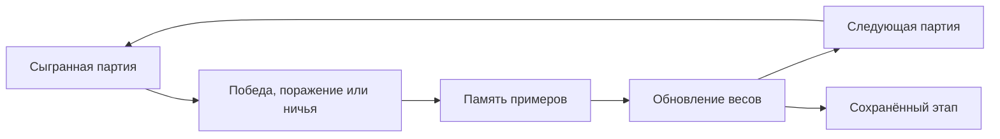

Крестики нолики с нейронкой

## Запуск

```sh
npm start
```

Локалка, не хостил

Для модулей JavaScript и Web Worker нужен HTTP-сервер, поэтому открытие `index.html` через `file://` не подойдёт.

## Возможности

| Настройка | Поведение |
| --- | --- |
| Первый ход | Рандом, ты или нейронка |
| Обучение на партиях | Нейронка обновляется после завершённой игры |
| Самообучение | Можно явно обучить от 100 до 10 000 игр |
| Сохранённые этапы | Начальная сеть и до семи следующих копий с фиксированными весами |
| Уверенность | Регулирует случайность выбора хода (чекбокс нужно нажать и на поле будет видно ) |
| Статистика | Счёт партий и график побед против случайного игрока, до 60 точек истории |
| Экспорт и импорт | Сохранение и загрузка обучения в формате JSON |
| Сброс сессии | Обнуление счёта и обучения, удаление этапов и очистка поля |

Клавиши 1–9 выбирают клетки слева направо, сверху вниз. «Новая партия» очищает поле, сохраняя счёт и обучение. При случайном старте первый игрок определяется заново.
После самообучения этап сохраняется автоматически. Можно сохранить его и вручную. Когда все восемь мест заняты, удаляется самая старая копия после начальной. Начальный этап остаётся.
Тренировку можно остановить, сохранив уже выполненные игры. Во время неё поле недоступно. Сброс сессии также останавливает активную тренировку.

## Обучение

Используется Double DQN со следующей архитектурой:

```text
  Поле с точки зрения игрока        Скрытый слой        Оценки ходов
           27 входов        ──────▶   48 нейронов  ──────▶  9 выходов
          one-hot / 3×3                 tanh                  Q
```

Начальные веса случайны. Сеть оценивает свободные клетки, занятые исключаются из выбора.



В текущей версии доля случайных тренировочных ходов снижается с 50% до 8%. Победный и последний проигрышный ход получают прямую обратную связь. Половина примеров для повторения берётся из эпизодов с известным исходом. Финальные решения дополнительно разбираются в восьми поворотах и отражениях поля.

На партию самообучения приходится 96 обновлений из памяти. Раньше их было 48, а доля случайных ходов после 1 000 партий оставалась около 74%. Новая версия требует меньше партий для обучения, но выполняет больше вычислений на каждую из них.

<details>
<summary>Параметры алгоритма</summary>

| Параметр | Значение |
| --- | --- |
| Память переходов | До 16 000 |
| Примеры с известным исходом | До 2 000 |
| Случайность самообучения | `ε = max(0.08, 0.5 × exp(−games / 1000))` |
| Награда за победу | `+1` |
| Последний ход перед победным ответом соперника | `−0.97` |
| Ничья | `0` |
| Обновление целевой сети | Каждые 240 шагов обучения из памяти |

Для обычного перехода используется цель:

```text
r − 0.97 × Q_target(next, argmax Q_online(next))
```

Минус учитывает смену игрока: следующим ходит соперник. Веса обновляются обратным распространением с ограниченной ошибкой. Партия пользователя даёт примеры ходов обеих сторон.

Формат весов совместим с предыдущей версией. Старые JSON-файлы и сохранённые этапы можно использовать с новым алгоритмом.

</details>

### Сохранение состояния

В браузере сохраняются веса, этапы, настройки, счёт и история проверок. При перезагрузке или завершении серии самообучения буферы примеров создаются заново. Начатая партия не восстанавливается.

Если закрыть страницу во время тренировки, несохранённая часть серии потеряется. Перед закрытием нужно нажать «Остановить».

### Уверенность и вероятности ходов

Уверенность задаёт температуру softmax. Чем выше значение, тем чаще сеть выбирает ход с лучшей оценкой. Это не меняет выученные веса и не гарантирует правильный ход.

Проценты на поле показывают вероятность выбора клетки, если бы сейчас ходил соперник. Это не вероятность победы.

График в приложении строится по 120 тестовым играм против случайного игрока с чередованием сторон. Он относится к текущей сети, даже если для игры выбрана сохранённая копия.

## Результаты проверки

Старый и новый алгоритмы сравнивались в трёх воспроизводимых запусках. На каждом этапе проводилось по 400 игр против случайного игрока. Начальные веса одинаковы, случайность обучения различается. В таблице приведены средние значения.

| Обучающих партий | Победы: до → после | Поражения: до → после |
| ---: | :---: | :---: |
| 500 | 69,3% → 81,4% | 27,4% → 17,1% |
| 1 000 | 75,9% → 84,8% | 22,8% → 11,4% |
| 2 000 | 78,0% → 82,7% | 20,1% → 5,2% |

После 2 000 партий сеть выбирает немедленную победу в 99,4% соответствующих достижимых позиций. Единственную непосредственную угрозу она блокирует в 70,3% позиций без собственного победного хода.

Результаты могут колебаться. Снижение доли побед между этапами иногда связано с ростом ничьих. Сеть остаётся учебной и может ошибаться независимо от количества партий и выбранной уверенности.

Исходные замеры: [до изменений](./scripts/benchmark-before.json) и [после изменений](./scripts/benchmark-after.json).
