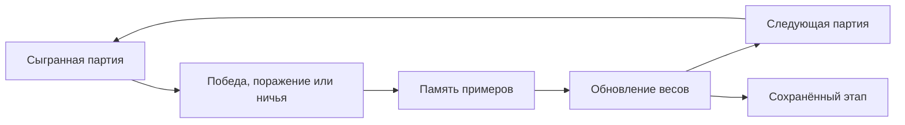

<div align="center">
  
  <h1>Нолик</h1>
  <p>Крестики-нолики с соперником, которого можно обучить.</p>
  <p>
    
    
    
    
  </p>
  <p>
    <a href="#быстрый-старт">Запуск</a> ·
    <a href="#что-умеет">Возможности</a> ·
    <a href="#как-учится-соперник">Обучение</a> ·
    <a href="#результаты-проверки">Результаты</a>
  </p>
</div>

---

Сначала соперник играет со случайными весами. После каждой партии он обновляет свою нейросеть: можно обучать его играми с собой, сохранять этапы и возвращаться к более ранним версиям.

Всё обучение происходит в браузере. **API-ключи, аккаунт и установка пакетов не нужны.** Ходы во время игры выбирает нейросеть; готовая выигрышная стратегия в неё не заложена.

## Быстрый старт

Понадобится **Node.js 20+**. В папке проекта выполните:

```sh
npm start
```

Откройте **[localhost:3000](http://localhost:3000)** — можно играть.

> Не открывайте `index.html` двойным щелчком: для JavaScript-модулей и фонового обучения нужен HTTP. Альтернативная команда запуска — `node server.mjs`.

## Что умеет

| | Возможность | Как работает |
| :---: | --- | --- |
| 🎲 | Первый ход | Случайно 50/50, вы или соперник. Первый игрок получает крестики. |
| 🧠 | Обучение на партиях | После завершённой игры обновляются веса текущей сети. Можно отключить. |
| ⚡ | Самообучение | Серии от 100 до 10 000 игр с собой в отдельном Web Worker. |
| 💾 | Сохранённые этапы | Начальная сеть и до семи следующих копий с фиксированными весами. |
| 🎚️ | Уверенность выбора | Регулирует случайность хода, сохраняя знания соперника. |
| 📊 | Проверка прогресса | График побед против случайного игрока, до 60 точек истории. |
| 📦 | Перенос обучения | Автосохранение в браузере, экспорт и импорт JSON. |
| ↺ | Сброс сессии | Очистка поля, счёта, обучения и этапов после подтверждения. |

<details>
<summary><strong>Управление и полезные мелочи</strong></summary>

- **Клавиши 1–9** выбирают клетки слева направо, сверху вниз.
- **Новая партия** очищает поле, сохраняя счёт и обучение. При случайном старте первый игрок определяется заново.
- **Сохранить этап** добавляет текущую сеть в список соперников. После самообучения этап сохраняется автоматически.
- **Остановить** завершает тренировку с сохранением уже выполненных игр.
- **Сбросить сессию** также останавливает активную тренировку. Для резервной копии сначала используйте экспорт.
- Когда все восемь мест для этапов заняты, вытесняется самая старая копия после начальной. Начальный этап остаётся.
- Интерфейс адаптирован к телефону и компьютеру.

</details>

## Как учится соперник

Небольшая сеть на чистом JavaScript:

```text
  Поле с точки зрения игрока        Скрытый слой        Оценки ходов
           27 входов        ──────▶   48 нейронов  ──────▶  9 выходов
          one-hot / 3×3                 tanh                  Q
```

Занятые клетки исключаются из выбора. В игре сеть оценивает доступные ходы, а уверенность определяет, насколько строго следовать лучшей оценке.



### Почему обучение теперь быстрее

В первой версии случайными оставались примерно **74% тренировочных ходов после 1 000 партий**. Победный ход получал прямую награду, а проигрыш предыдущего игрока сеть должна была выводить косвенно.

Теперь:

- доля случайных ходов снижается с **50% до 8%**, оставляя возможность искать новые решения;
- победный и последний проигрышный ход получают прямую обратную связь;
- половина повторяемых примеров берётся из эпизодов с известным исходом;
- финальные решения разбираются сразу в восьми поворотах и отражениях поля;
- на одну партию самообучения приходится **96 обновлений из памяти** вместо 48.

Сеть получает больше пользы от каждой партии. Вычислительной работы на партию стало больше; улучшение касается прежде всего количества игр, необходимых для обучения.

<details>
<summary><strong>Технические детали Double DQN</strong></summary>

- Память — до **16 000 переходов**, отдельно до **2 000 примеров с известным исходом**.
- Случайность самообучения: `ε = max(0.08, 0.5 × exp(−games / 1000))`.
- Для обычного перехода цель: `r − 0.97 × Q_target(next, argmax Q_online(next))`. Минус учитывает, что следующим ходит противник.
- Победа даёт `+1`, последний ход проигравшего перед победным ответом — `−0.97`, ничья — `0`.
- Целевая сеть обновляется каждые 240 шагов обучения из памяти.
- Примеры поворачиваются и отражаются; веса обновляются обратным распространением с ограниченной ошибкой.
- Партия пользователя даёт примеры ходов обеих сторон.
- Архитектура и формат весов сохранены: старые JSON-файлы и этапы совместимы. Улучшенный алгоритм применяется при следующем обучении.

При перезагрузке или завершении серии самообучения буферы примеров создаются заново; выученные веса сохраняются. Начатая партия не восстанавливается. Перед закрытием страницы во время тренировки лучше нажать «Остановить».

</details>

## Результаты проверки

Сравнение старого и нового алгоритмов: **три воспроизводимых запуска**, по **400 тестовых игр против случайного игрока** на каждом этапе. Стороны чередуются; начальные веса одинаковы, случайность обучения различается.

| Обучающих партий | Победы: до → после | Поражения: до → после |
| ---: | :---: | :---: |
| 500 | 69,3% → **81,4%** | 27,4% → **17,1%** |
| 1 000 | 75,9% → **84,8%** | 22,8% → **11,4%** |
| 2 000 | 78,0% → **82,7%** | 20,1% → **5,2%** |

Дополнительно после 2 000 партий сеть выбирает немедленную победу в **99,4%** соответствующих достижимых позиций и блокирует единственную непосредственную угрозу в **70,3%** позиций без собственного победного хода.

> Это учебный соперник, который всё ещё ошибается. Снижение доли побед между этапами может сопровождаться ростом ничьих. Ни количество партий, ни высокая уверенность не гарантируют безошибочную игру.

Исходные замеры: [до изменений](./scripts/benchmark-before.json) · [после изменений](./scripts/benchmark-after.json).

### Запустить проверки

```sh
npm test
npm run benchmark
```

Тесты проверяют правила, допустимость ходов на всех достижимых позициях, выбор первого игрока, сохранения, сброс тренировки и качество обучения на ранних этапах. Бенчмарк отдельно выводит победы, поражения, выбор победного хода и блокирование угроз.

<details>
<summary><strong>Что означает «уверенность» и что показывает график</strong></summary>

**Уверенность** управляет температурой softmax — случайностью выбора хода. Она не добавляет сети знаний. Даже при 100% уверенности можно получить ошибку, если оценки сети неверны.

**Проценты на поле** — вероятность выбора свободных клеток, если бы сейчас ходил соперник. Это не вероятность победить.

**График в приложении** строится по 120 играм против случайного соперника с чередованием сторон. Он показывает текущую сеть, а не выбранную историческую копию. Значения могут колебаться. Для более подробного сравнения используйте отдельный бенчмарк выше.

</details>

## Структура проекта

```text
.
├── index.html                 # Страница и диалоги
├── style.css                  # Адаптивное оформление
├── app.js                     # Партии, настройки, этапы и сохранения
├── neural.js                  # Сеть, обучение и правила игры
├── training-worker.js         # Фоновое самообучение
├── server.mjs                 # Локальный HTTP-сервер
├── scripts/
│   ├── benchmark-training.mjs # Воспроизводимая оценка качества
│   └── benchmark-*.json       # Сравнение до и после улучшения
└── tests/
    ├── neural.test.mjs         # Правила и качество обучения
    ├── app.test.mjs            # Сценарии приложения
    └── worker.test.mjs         # Тренировка и её остановка
```

## Оформление и размещение

Светлый интерфейс с белыми блоками и синим акцентом. За основу взяты цвета и скругления UI-библиотеки RST: фон `#F5F8FB`, текст `#0D1E2C`, акцент `#4299FF`, скругления кнопок `8px`. Используется системный шрифт, код и зависимости RST не подключаются.

Локальный сервер доступен только на этом компьютере. Другой порт задаётся переменной окружения `PORT`. Приложение также можно разместить на статическом HTTP-хостинге: серверная логика для игры и обучения не требуется.

---

<div align="center">
  <sub>JavaScript · Double DQN · Web Workers · localStorage</sub>
</div>
